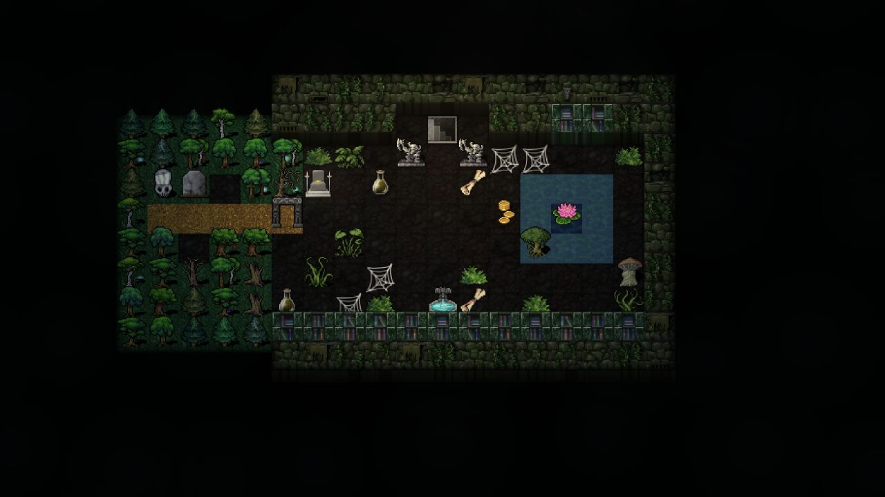

<p align="center"></p>

# Orbrun — DCSS Client

**Dungeon Crawl Stone Soup in a 2.5D dungeon, with keyboard, gamepad and touch controls.**

[Play or watch](https://dcss-client.vittis.workers.dev/) · [Controls and privacy](ABOUT.md) · [Engineering baseline](project-notes/README.md)

This fork of [Caeous's Orbrun](https://github.com/Caeous/orbrun) connects to the public DCSS WebTiles servers. Accounts, saves, rc files and gameplay remain on the selected server. Anonymous spectating needs no account.

Dungeon (2.5D) is the gameplay view: slanted floors, raised walls, upright creatures, lighting, spell effects and confirmed combat feedback. Tilt, zoom, animation and movement presentation remain configurable. Still mode and reduced motion limit animation. Traditional flat tiles remain for the minimap and temporary level-map/overview displays; closing a map returns to the dungeon. Movement and targeting use compass directions.

<p align="center"></p>

The hosted build supports online play on the bundled HTTPS/WSS servers. Offline engines and custom-server development remain in the repository, but are disabled in production. Installing the site saves its shell; hosted gameplay still needs a connection.

## Play

Use **Watch** to spectate, or **Play** to choose your account's server. The HUD includes server menus, prompts, messages, stats, chat, targeting and the monster list. The action bar describes the current gamepad or touch controls.

- [Keyboard, controller and touch guide](ABOUT.md#controls)
- [Add to Steam](STEAM.md)
- [Add to Home Screen](INSTALL.md)
- [Release notes](CHANGELOG.md)

## Develop

Use Node 24.11.1 and npm 11.6.2, the verified web toolchain.

```sh
npm ci --include=dev
npm run dev -w apps/orbrun -- --host 127.0.0.1
npm run typecheck -- --force
npm test
npm run e2e
npm run build
```

Development and preview include the bounded gamedata proxy; WebSockets connect directly to the selected DCSS server. Optional engine tests report explicit skips when their artifacts are missing. [CONTRIBUTING.md](CONTRIBUTING.md) and the [runbook](project-notes/RUNBOOK.md) explain fixtures, browser checks and release validation.

## Packages

| Package | Responsibility |
|---|---|
| [webtiles](packages/webtiles) | Connection, protocol, formatting and mutable server-state reducer |
| [gamedata](packages/gamedata) | Bounded non-executing parsing of server enums/tile tables and atlas loading |
| [scene](packages/scene) | Render-facing cells, sprites, directions and presentation contracts |
| [scene-webtiles](packages/scene-webtiles) | DCSS state and gamedata to scene composition |
| [render-2.5d](packages/render-2.5d) | Canvas dungeon renderer and confirmed visual effects |
| [render-2d](packages/render-2d) | Flat supporting views and minimap |
| [vault](packages/vault) | Restricted DCSS `.des` parser and scene compiler for bundled scenery |
| [offline](packages/offline) | Development/offline WebAssembly engine integration |

`apps/orbrun` owns the app, controls, sessions, menus, settings, HUD and Worker. `engine/` builds optional offline artifacts. No UI-framework or protocol replacement is part of this baseline.

## License and credits

[AGPL-3.0-or-later](LICENSE). Copyright © 2026 the Orbrun developer. This is an independent, unofficial DCSS client. Upstream authorship, DCSS-derived code, artwork, fonts, PocketZot and Super Dungeon Crawl credits are recorded in [ATTRIBUTION.md](ATTRIBUTION.md). The hosted About page links the exact corresponding source for its release.

Report fork issues at [vittis/orbrun](https://github.com/vittis/orbrun/issues).
