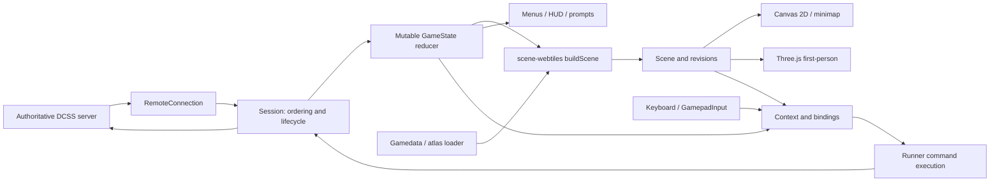

# Architecture assessment

Observed at Orbrun `b65fc15ca1b58969cb061a7749db8cbdb92b8f4d` on 2026-11-11. Proposed changes below are not implemented. Full evidence: [architecture review](reviews/architecture.md), [controls review](reviews/controls.md), [security review](reviews/security.md).

## Observed system

An npm/TypeScript workspace with a Vite application and eight local libraries. No new UI framework is needed to initialize this project.

| Package / owner | Responsibility | Dependencies / coupling |
|---|---|---|
| `packages/webtiles` | Connection, key/messages, formatting, authoritative mutable GameState reduction | No package dependencies; injectable WebSocket constructor |
| `packages/gamedata` | Server/version AMD enums, tile tables, atlas images, flag decoding | No package dependencies; executes fetched JavaScript today |
| `packages/scene` | Cells, billboards, directions, camera, motion timing, TileSource/MapRenderer | No package dependencies; some first-person fields |
| `packages/scene-webtiles` | DCSS semantic interpretation and incremental Scene construction | webtiles, gamedata, scene |
| `packages/render-2d` | Canvas tiles/glyphs/hybrid/minimap | scene |
| `packages/render-3d` | First-person Three.js, custom shaders, instancing, chunked geometry | scene + Three peer |
| `packages/vault` | Restricted `.des` parsing; front room | scene, scene-webtiles |
| `packages/offline` | Real DCSS WASM engine/worker behind Connection | webtiles; optional engine build artifacts |
| `apps/orbrun` | Accounts, Session, game screen, input, menus, HUD, settings, proxies | All libraries; controller code is app-local |

This is a dependency/data-flow sketch, not a claim that every component is decoupled. `Runner` also drives the camera, and `GameScreen` coordinates concrete renderer details.

### State and lifecycle

`RemoteConnection` (`packages/webtiles/src/connection.ts`) unpacks ordered JSON batches, answers ping, queues pre-open sends, rejects stale socket generations and supports reopen. It requests `no-compression`; it does not inflate application-level compressed frames. Runtime type assertions are not validation (a null batch item throws).

`Session.handle/apply/flushScene` (`apps/orbrun/src/session.ts`) owns most connection/reduction/gamedata sequencing and builds scenes at flush boundaries. `reduce` (`packages/webtiles/src/state.ts:1292`) mutates and returns the same GameState, including nested maps/objects; `rev`, dirty cells and clear flags drive consumers. The webtiles README's immutable claim is wrong. Existing ownership is not strictly single-writer: `menu.ts:718` clears `session.state.exit`. A single state owner is a proposed stabilization rule, not a baseline fact.

`buildScene` reuses untouched cells but still scans the known map. `Billboard.ref` can retain mutable Monster objects. Do not retain state/ref identities as historical snapshots or let effects mutate them. If animation needs history, copy only stable entity identity, confirmed position and required visual attributes. The option-only scene invalidation suspicion is unconfirmed by runtime and requires a focused regression test before changing code.

### Rendering and UI

`MapRenderer` in `packages/scene/src/index.ts:540` has `mount`, `setTiles`, `setScene(scene, now?)`, `setCamera`, `setCursor`, `render(now?)`, `pick`, `resize`, `destroy`. Optional timestamps are seconds on a shared monotonic presentation clock. `TileSource` provides atlas rectangles/images independently of protocol.

Both renderers implement the contract, but `GameScreen` has concrete renderer branches for layout, warmup, animation scheduling, touch projection, viewmodel and parking. Scene cells contain ceiling/stance/face details; Camera requires eye/yaw/pitch/facing. Keep the contract provisionally, without adding every renderer-specific feature to it. `render-3d/README.md` mentions removed files; inspect current `sprites.ts`, `level-mesh.ts`, and `shaders.ts`.

Canvas is implemented and browser-tested in the room testbed and live minimap. Full primary 2D gameplay is not verified: `VIEW_OPTIONS=false` (`servers.ts:609`) hides the selector and `getSettings` forces 3D. Drawing-call tests do not prove visual equivalence to official WebTiles.

### Input

`main.tick` polls gamepads on animation frames when active, with idle polling and connection wakeups. `gamepad.ts` handles device normalization, hysteresis, repeats and disconnect releases. `bindings.ts` maps events/context to actions; `context.ts` combines server mode, menu state, prompt-text exceptions and scene/camera queries; `Runner` sends commands and manages camera-relative semantics. `keys.ts` encodes browser keys into WebTiles codes.

The raw adapter is reusable. Gameplay interpretation is not yet renderer-independent. `Runner.absolute/absoluteAim/step`, targeting orbit, `deriveContext`'s ahead cell, and `GameScreen.onKeyDown` all matter. Changing Canvas selection alone is insufficient. Preserve keyboard Shift/Ctrl, raw text, modifiers, macros and mode routing while introducing absolute world directions. Held gamepad movement currently repeats individual steps; it is not generally a server run command.

## Alternatives decision matrix

Qualitative estimates from source, not benchmark scores or schedules.

| Criterion | A: full Orbrun fork | B: selected packages + new app | C: official WebTiles base |
|---|---|---|---|
| Effort to controller-first top-down | Lowest expected; orientation/UI isolation | Higher; valuable controls/menus are app-local | Higher; native top-down, controller orchestration must be established |
| Official server compatibility | Existing protocol/fixtures; CDI spectate verified only | Same inherited protocol limits | Closest reference; separate hosting/account integration still work |
| Controller completeness | Retains context, OSK, focus and command menus | Rebuild or extract app interaction stack | This review did not exhaustively establish gamepad support |
| Top-down / optional 2.5D | Existing Canvas; semantic tiles available | Same if retaining scene | Native map; new effects integration work |
| Security | Confirmed gamedata/proxy hardening needed | Reusing loader/proxy inherits risks | Native server-origin trust differs from multi-server origin |
| Maintainability | Large first-person app; incremental cleanup | Smaller end state possible at parity-rebuild cost | AMD/jQuery/global DOM integration in inspected client/game code |
| Licensing | AGPL + GPL-derived/source/asset obligations | Extraction does not erase obligations | GPL/source and asset provenance still apply |
| Tests | 1,836 tests pass; default suite has artifact-gating failure | Library tests retained; app coverage rebuilt | No comparable full suite audit conducted |
| Performance | Canvas and measured comparison path available | No automatic speed benefit | No comparative benchmark obtained |
| Upstream maintenance | Preserved history and small patches | Manual synchronization/extraction drift | Direct DCSS changes but larger integration scope |
| Inherited complexity | Highest retained footprint initially | Lower footprint only after extraction | Client/server coupling and new controller work |

**Decision: A, conditionally through Phase 2.** The broad existing interaction system plus Canvas outweigh first-person cleanup cost. The two reviewers agree, but require a complete tested top-down slice before broad extraction. Revisit if ordinary direction/target/context changes keep forcing unrelated UI rewrites or if protocol/visual mismatches dominate. Option C is the interoperability reference, not dismissed as intrinsically inferior. Inspection covered current official `client.js` and `game.js`, not a pinned comprehensive official-client audit. Super Dungeon Crawl could not be retrieved through the available web fetches; no code/assets imported or implementation/license claims made.

## Proposed target and migration treatment

| Boundary | Target responsibility | Treatment |
|---|---|---|
| Connection/authentication | Secure transport, lifecycle, token scope, bounded decode | Preserve API; harden validation, secure transport and error behavior |
| Protocol/GameState | Sole authoritative state projection with explicit revisions | Preserve mutable model; migrate direct UI writes to owner methods |
| Scene/view model | Read-only confirmed world representation | Retain initially; snapshot effect history explicitly; narrow 3D-specific fields only as needed |
| Input/commands | Device normalization → mode-aware world intent → one encoder/send path | Preserve adapter/menus; implement absolute-direction policy and explicit interaction target |
| Renderer | Draw known scene; pick cells; manage resources | Canvas primary first; no gameplay direction decisions |
| Effects | Confirmed movement interpolation, visual feedback, bounded queues | Add later; cancel/reset on teleport, reconnect, level change, burst or reduced-motion preference |
| UI | Existing inventory, spells, targeting, shops, prompts, HUD/OSK | Preserve until interaction matrix passes; incremental extraction only |
| Assets | Server/version cache, validated data, atlas lifecycle | Isolate executable data and restrict proxy; no credentials in asset cache |

Initially these are ownership rules and small app modules, not eight new services/packages. No duplicate GameState, speculative ECS, general event bus or new UI framework. Existing offline engine remains optional for fixtures/test coverage; official online play never uses it to predict results. Do not remove first-person/reference code until a verified replacement makes removal safe.

## Renderer decision gate

Canvas can establish correct top-down output and modest effects without a new dependency. PixiJS is a candidate for larger sprite/effect workloads; its official guidance describes batching, texture lifecycle and costly masks/filters. That supports a focused spike, not a measured advantage in this app. [PixiJS performance guidance](https://pixijs.com/8.x/guides/concepts/performance-tips).

Phase 3 compares the same recorded scenes on target hardware: layer/visibility/cursor parity first, then p50/p95 frame time, input-to-send latency, memory, atlas upload, idle work and recovery. Choose target budgets before measuring and record browser/hardware/load. Keep Canvas if it meets the chosen effects budget. Adopt Pixi only if measured benefits or a required effect justify migration/maintenance costs. Do not maintain three feature-equivalent primary rendering stacks.

Optional 2.5D starts with sprite offsets, shadows and depth ordering in the chosen renderer. A Three.js orthographic path is a future experiment only if geometry/camera requirements cannot be met simply. Preserve square-grid readability, picking and world-direction controls under any presentation projection.
